# Catálogo de Libros — API REST en EC2 con RDS y CI/CD

Solución del Segundo Examen Parcial de **Trabajando en la Nube (COM610)** — Universidad San Francisco Xavier de Chuquisaca (Semestre 2/2026).

El proyecto implementa una API REST con **Node.js** y **Express** conectada de forma privada a **Amazon RDS (MySQL)**, publicada mediante **Nginx** como proxy inverso en **Amazon EC2**, e integrada con pipelines de **CI/CD en GitHub Actions** y **Docker**.

## Enlaces de entrega y verificación

- **URL pública de la API:** `http://18.208.247.9`
  - Estado del servicio: `http://18.208.247.9/health`
  - Catálogo de libros: `http://18.208.247.9/libros`
- **Ejecución exitosa de CI:** [Actions Run #44642925785](https://github.com/jharifAparicio/2_parcial/actions/runs/44642925785)
- **Ejecución exitosa de CD:** [Actions Run #44645375310](https://github.com/jharifAparicio/2_parcial/actions/runs/44645375310)

---

## Estructura del repositorio

- [`src/app.js`](src/app.js): rutas de la API, validación de datos y respuestas HTTP.
- [`src/db.js`](src/db.js): pool de conexiones a MySQL (`mysql2/promise`) y consultas parametrizadas.
- [`src/server.js`](src/server.js): punto de entrada del servidor Express (puerto `3000`).
- [`tests/libros.test.js`](tests/libros.test.js): pruebas automatizadas con Jest y Supertest usando un doble de prueba (`mockDb`).
- [`db.sql`](db.sql): script SQL para crear la base de datos `catalogo_libros` y la tabla `libros`.
- [`Dockerfile`](Dockerfile) y [`.dockerignore`](.dockerignore): empaquetado de la API en contenedor (`node:24-alpine`).
- [`.github/workflows/ci.yml`](.github/workflows/ci.yml): workflow de integración continua (`npm ci` y `npm test`).
- [`.github/workflows/cd.yml`](.github/workflows/cd.yml): workflow de despliegue continuo (pruebas, build/push de imagen y deploy con rollback en EC2).
- [`.env.example`](.env.example): plantilla de variables de entorno con valores ficticios.
- `evidencias/`: capturas de pantalla de la infraestructura en AWS, pruebas, Docker y GitHub Actions.

---

## Cómo ejecutar la aplicación y las pruebas

### 1. Ejecutar pruebas automatizadas (sin RDS)

Las pruebas inyectan un repositorio simulado (`mockDb`) en `createApp`, por lo que no requieren conexión a una base de datos real:

```bash
npm ci
npm test
```

### 2. Ejecutar la API localmente con Node.js

1. Crea un archivo `.env` a partir de `.env.example` con los datos de tu base MySQL/RDS:
   ```bash
   cp .env.example .env
   ```
2. Inicia el servidor:
   ```bash
   npm start
   ```

### 3. Ejecutar la API con Docker localmente

```bash
docker build -t api-libros:local .
docker run -d --name api-libros-test --env-file .env.example -p 127.0.0.1:3000:3000 api-libros:local
curl -i http://127.0.0.1:3000/health
```

### 4. Cómo verificar el despliegue en producción

Desde cualquier equipo con acceso a Internet se puede consultar la API publicada en el puerto `80` a través de Nginx:

```bash
curl -i http://18.208.247.9/health
curl -i http://18.208.247.9/libros
```

En `GET /health`, el campo `version` refleja el SHA del commit desplegado automáticamente por el pipeline de CD (`APP_VERSION=${{ github.sha }}`).

---

## Parte 1 — API REST en EC2 con base de datos RDS

### 1. Recursos de AWS y grupos de seguridad

Todos los recursos se desplegaron en la región **us-east-1 (Norte de Virginia)** dentro de la misma VPC (`vpc-002344bb0e19566ba`), con grupos de seguridad separados:

- **Grupo de seguridad EC2 (`sg-ec2-jharif` / `sg-0016900dee7174c87`)**:
  - **SSH (TCP `22`)**: permitido únicamente desde la IP pública del equipo (`166.114.186.38/32`).
  - **HTTP (TCP `80`)**: abierto a Internet (`0.0.0.0/0`) para el proxy inverso Nginx.
  - El puerto `3000` permanece cerrado al exterior.

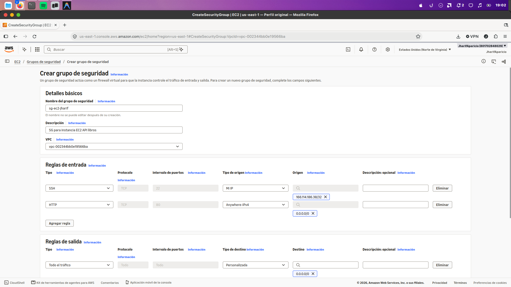

- **Grupo de seguridad RDS (`sg_rds_jharif` / `sg-06d0056bed515d6c2`)**:
  - **MySQL/Aurora (TCP `3306`)**: tráfico de entrada permitido únicamente desde el grupo de seguridad de la instancia EC2 (`sg-0016900dee7174c87`), sin exposición a Internet.

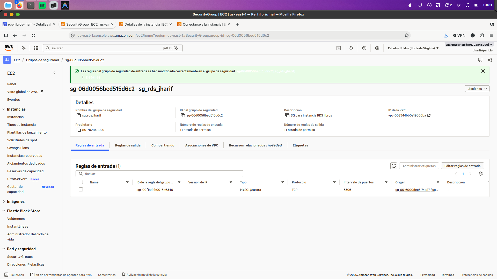

- **Instancia RDS (`rds-libros-jharif`)**: MySQL `8.4.11` en `us-east-1f`, con **acceso público deshabilitado** y endpoint privado `rds-libros-jharif.cqpek06ow2gl.us-east-1.rds.amazonaws.com`.

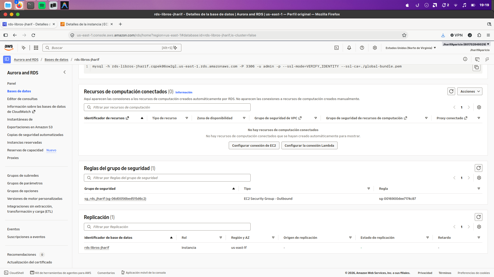

- **Instancia EC2 (`ec2-libros-jharif` / `i-00cffa0f699dce026`)**: tipo `t3.micro` con Ubuntu 26.04, IP pública `18.208.247.9` e IP privada `172.31.18.162`.

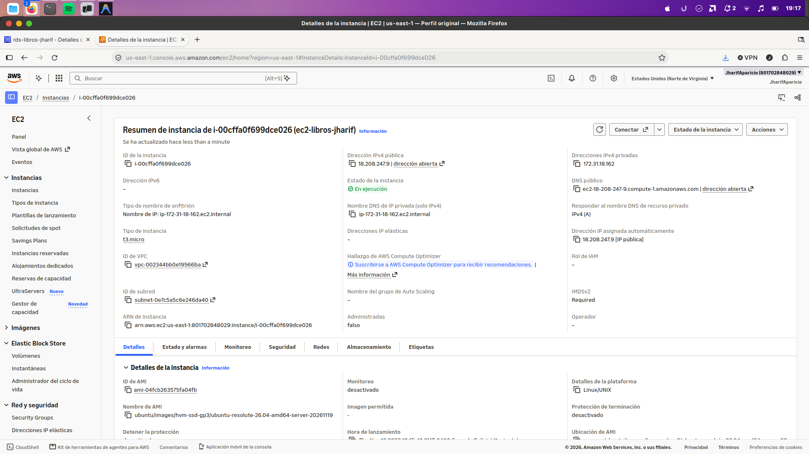

### 2. Base de datos y modelo SQL

Desde la instancia EC2 se descargó el certificado CA de RDS (`global-bundle.pem`) y se ejecutó [`db.sql`](db.sql) para crear la base de datos `catalogo_libros` y la tabla `libros` (`id`, `titulo`, `autor`, `anio_publicacion`), verificando su esquema con `DESCRIBE libros;`.

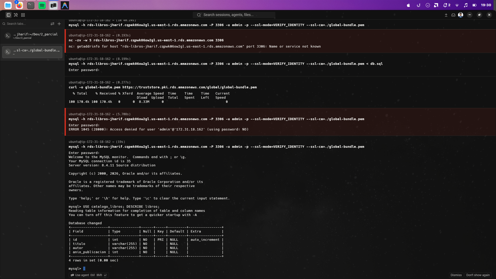

### 3. Implementación de la API y despliegue inicial

La API utiliza `mysql2/promise` con consultas parametrizadas (`?`), lee la configuración desde variables de entorno y valida que `titulo` y `autor` no estén vacíos y que `anio_publicacion` sea un entero válido (respondiendo `400` ante datos inválidos).

| Método y ruta | Comportamiento implementado |
| --- | --- |
| `GET /health` | Devuelve `200` con `{ "status": "ok", "version": "..." }`. |
| `GET /libros` | Devuelve la lista de libros almacenados en RDS (`200`). |
| `GET /libros/:id` | Devuelve el libro solicitado (`200`) o `404` si no existe. |
| `POST /libros` | Crea un libro válido y devuelve `201` con el registro creado (`400` si es inválido). |
| `PUT /libros/:id` | Actualiza un libro existente (`200`), `400` si es inválido o `404` si no existe. |
| `DELETE /libros/:id` | Elimina un libro existente (`200`) o devuelve `404` si no existe. |

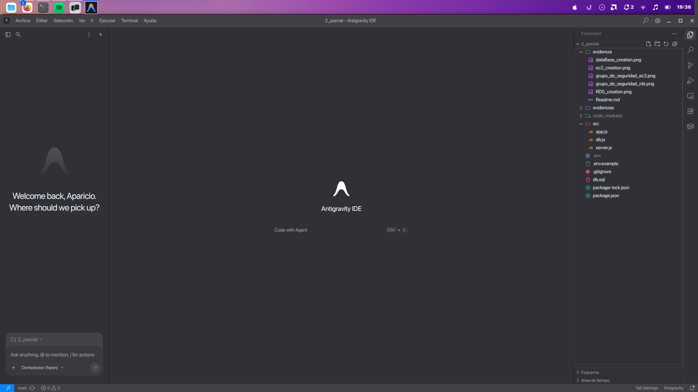

Se probó la ejecución en la EC2 y las respuestas locales en `http://127.0.0.1:3000/health` y `http://127.0.0.1:3000/libros`.

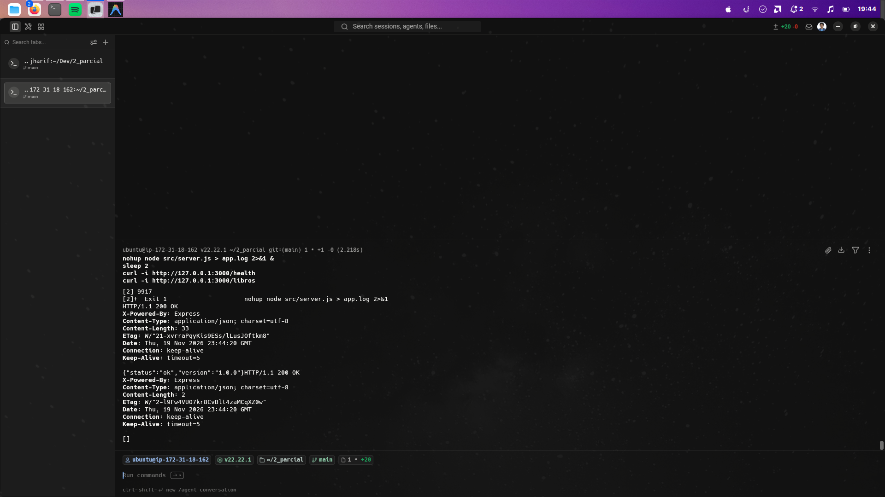

### 4. Publicación con Nginx y pruebas CRUD externas

Se instaló Nginx en la instancia EC2 y se configuró `/etc/nginx/sites-available/default` como proxy inverso en el puerto `80` apuntando a `http://127.0.0.1:3000`, validando con `sudo nginx -t` y habilitando el servicio con `systemctl`.

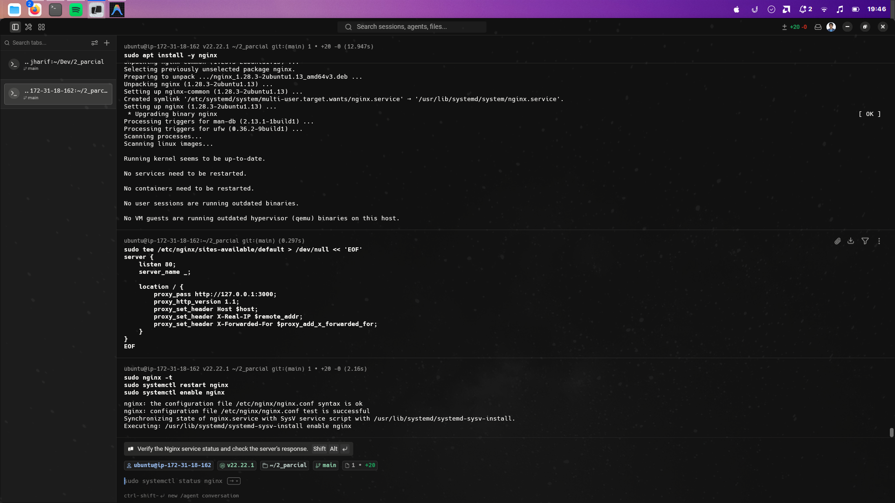

Desde el equipo local se verificaron las cuatro operaciones CRUD contra `http://18.208.247.9`:

- **Creación (`POST /libros`)** y **consulta (`GET /libros`, `GET /libros/1`)**: creación del libro *"Clean Code"* de *"Robert C. Martin"* (`2008`) con respuesta `201 Created` y consulta posterior `200 OK`.

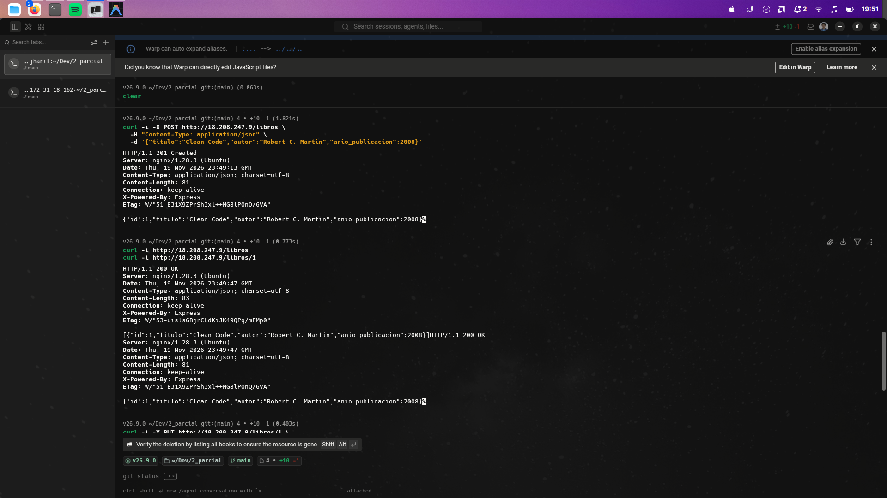

- **Actualización (`PUT /libros/1`)**, **eliminación (`DELETE /libros/1`)** y **verificación (`GET /libros/1`)**: actualización a *"Clean Code (2da Ed)"* (`2009`) con `200 OK`, eliminación (`200 OK`) y posterior consulta devolviendo `404 Not Found` (`{"error":"Libro no encontrado"}`).

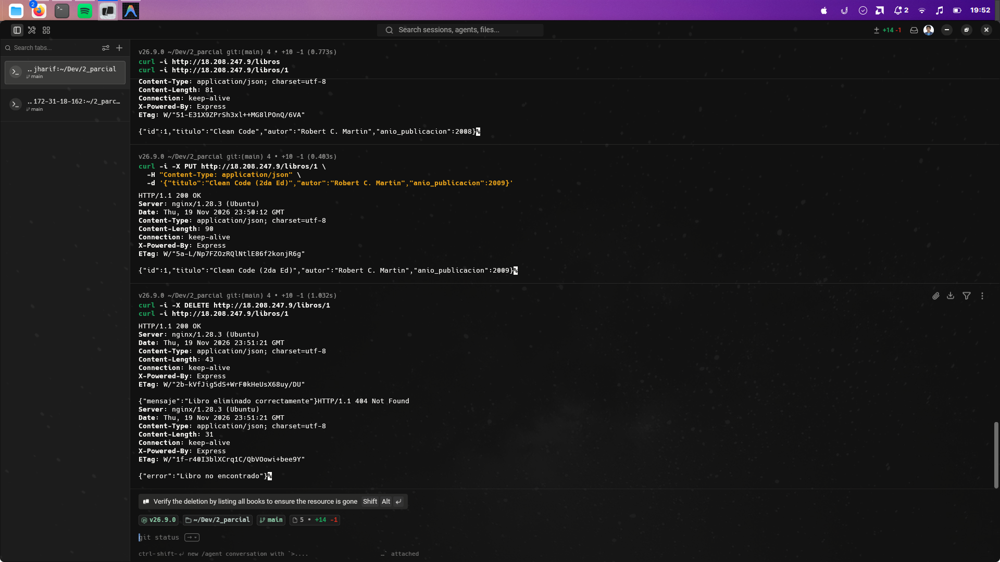

---

## Parte 2 — CI/CD con GitHub Actions y Docker

### 1. Pruebas automatizadas con Jest y Supertest

En [`tests/libros.test.js`](tests/libros.test.js) se implementaron 4 pruebas unitarias/de integración sin dependencia de RDS real mediante un `mockDb`:

1. `GET /health` devuelve `200` y `status: 'ok'`.
2. `POST /libros` crea un libro válido y devuelve `201`.
3. `POST /libros` rechaza datos inválidos con `400`.
4. `GET /libros/:id` devuelve `404` cuando el registro no existe.

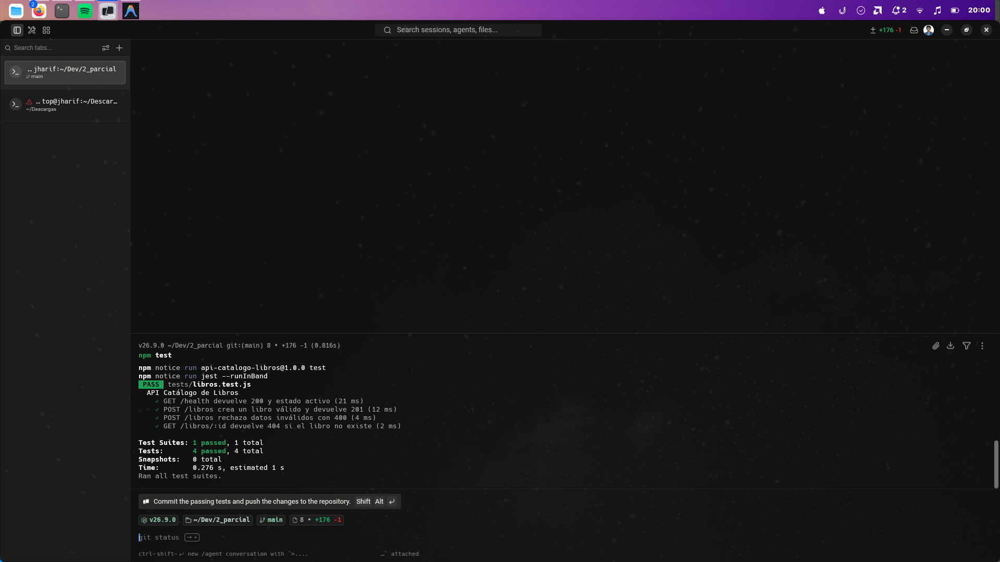

### 2. Workflow de Integración Continua (CI)

El archivo [`.github/workflows/ci.yml`](.github/workflows/ci.yml) se ejecuta en cada `push` y `pull_request` hacia `main`, instalando dependencias con `npm ci` y ejecutando `npm test` en Node.js 24.

- **Ejecución verificada:** [Actions Run #44642925785](https://github.com/jharifAparicio/2_parcial/actions/runs/44642925785)

### 3. Contenerización con Docker

Se creó el [`Dockerfile`](Dockerfile) basado en `node:24-alpine` (instalando solo dependencias de producción con `npm ci --omit=dev` y exponiendo el puerto `3000`). La imagen `api-libros:local` se construyó y probó localmente pasando las variables de entorno con `--env-file .env.example` y verificando `GET /health` (`200 OK`).

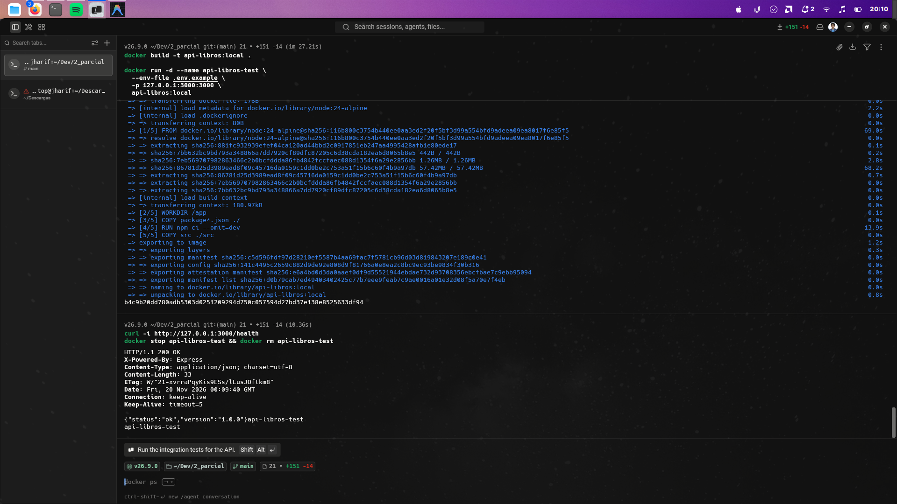

### 4. Secrets, preparación de EC2 y Workflow de CD con rollback

Las credenciales del registro de contenedores y de acceso SSH a la EC2 se almacenaron como **GitHub Actions Secrets** (`EC2_HOST`, `EC2_USER`, `EC2_SSH_KEY`, `REGISTRY_URL`, `REGISTRY_USER`, `REGISTRY_PASSWORD`), manteniendo el archivo `.env` con las credenciales reales de RDS únicamente dentro de `/home/ubuntu/.env` en la instancia EC2.

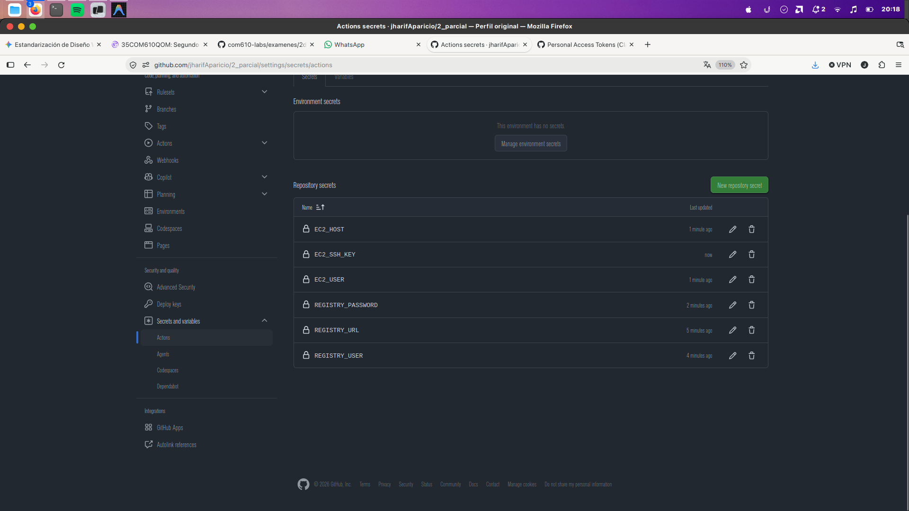

En la instancia EC2 se instaló Docker y se detuvo el proceso previo de Node.js para dejar la gestión del servicio exclusivamente en contenedores detrás de Nginx (mapeado a `127.0.0.1:3000:3000`).

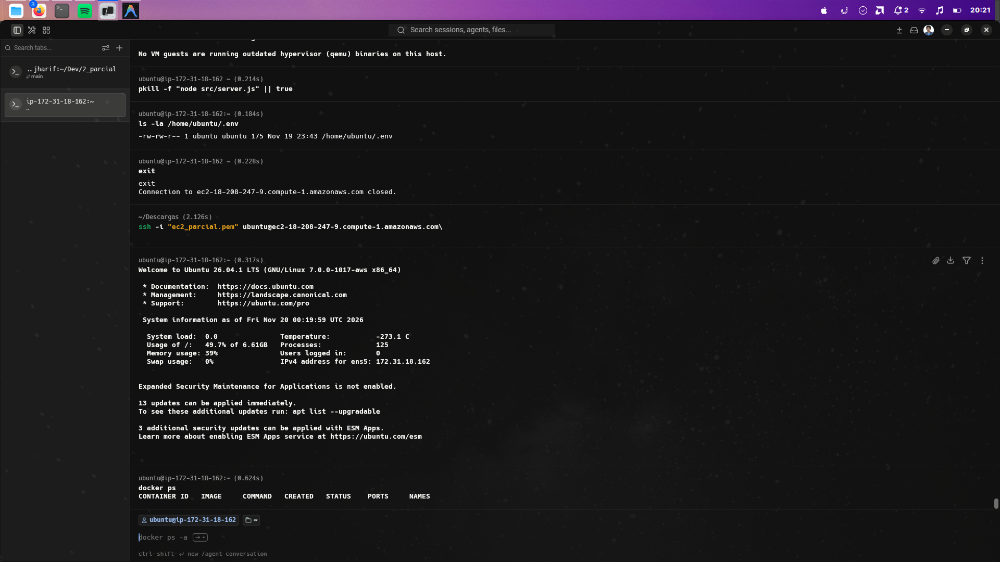

El workflow [`.github/workflows/cd.yml`](.github/workflows/cd.yml) se ejecuta solo en `push` a `main` y encadena tres trabajos dependientes:

1. **`test`**: ejecuta `npm ci` y `npm test`.
2. **`build-and-push`** (`needs: test`): construye la imagen Docker y la publica en el registro etiquetada con `${{ github.sha }}`.
3. **`deploy`** (`needs: build-and-push`): descarga la nueva imagen en EC2, guarda la imagen anterior (`PREV_IMAGE`), levanta el contenedor con `APP_VERSION=${{ github.sha }}` y verifica `http://127.0.0.1/health` y `http://127.0.0.1/libros`. Si la comprobación falla, restaura automáticamente `PREV_IMAGE` y marca el despliegue como fallido.

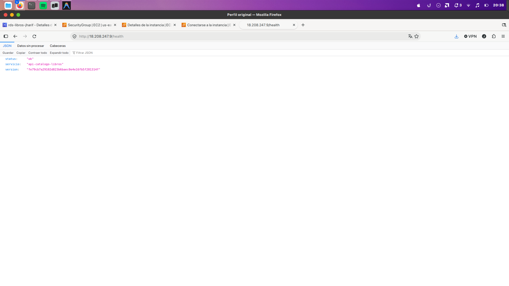

- **Ejecución verificada:** [Actions Run #44645375310](https://github.com/jharifAparicio/2_parcial/actions/runs/44645375310)
