# paso 1.1
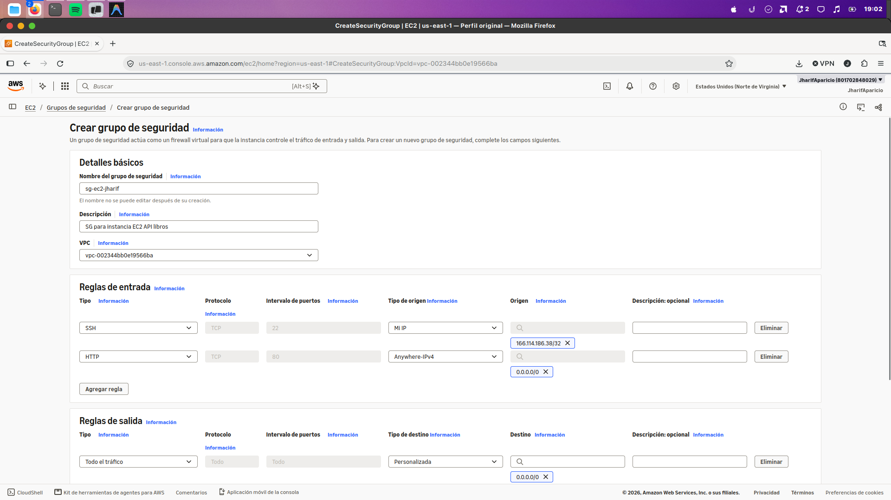

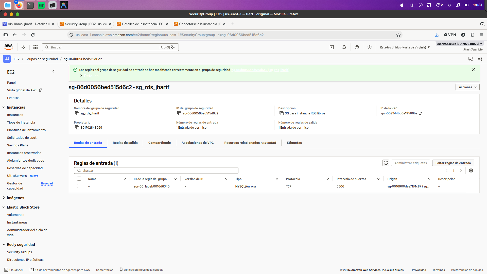

# paso 1.2
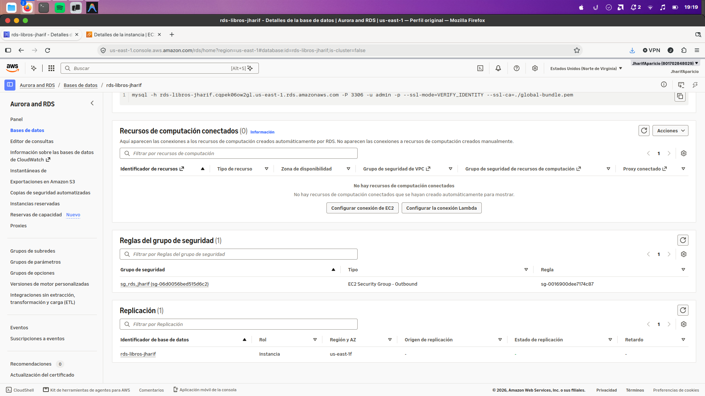

# paso 1.3 
ip ec2 = 18.208.247.9
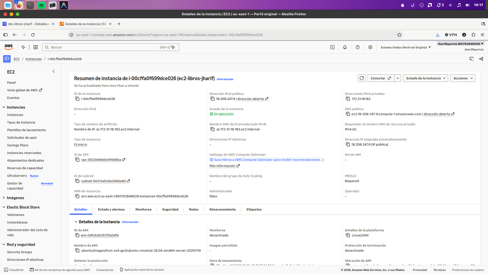

# paso 1.4
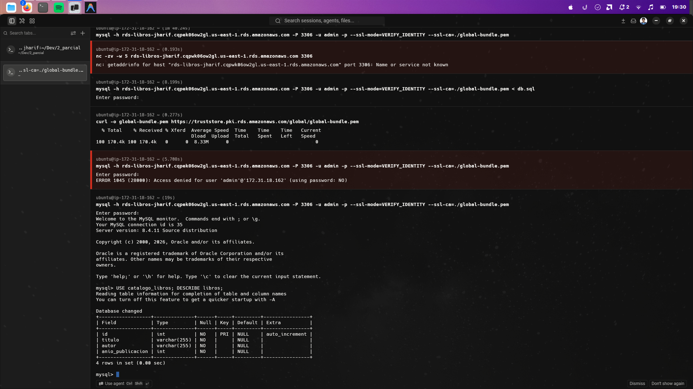

# paso 1.5
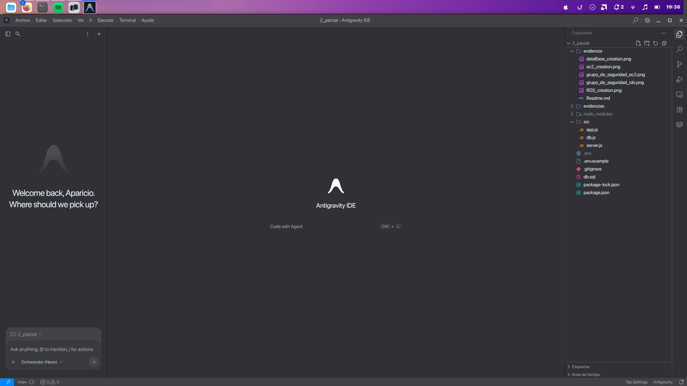

# paso 1.6
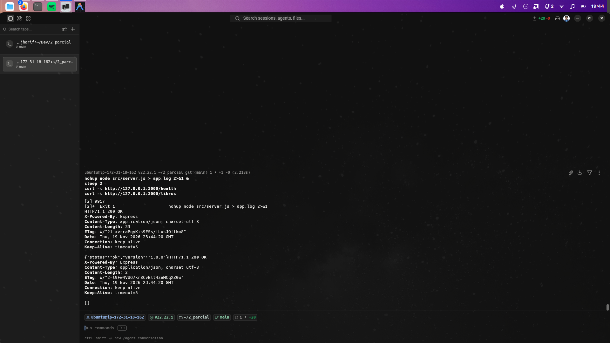

# paso 1.7
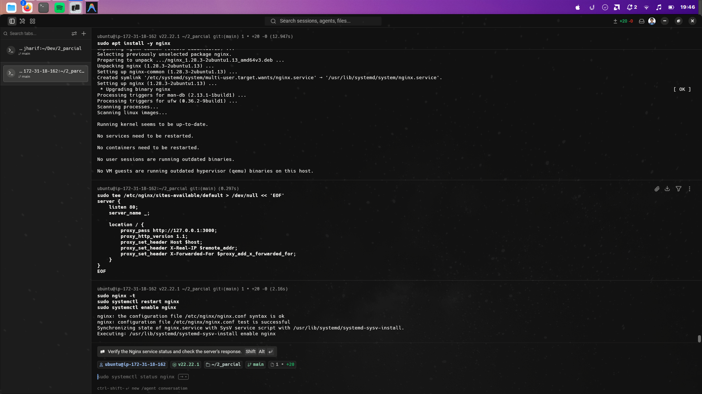

# pruebas operaciones
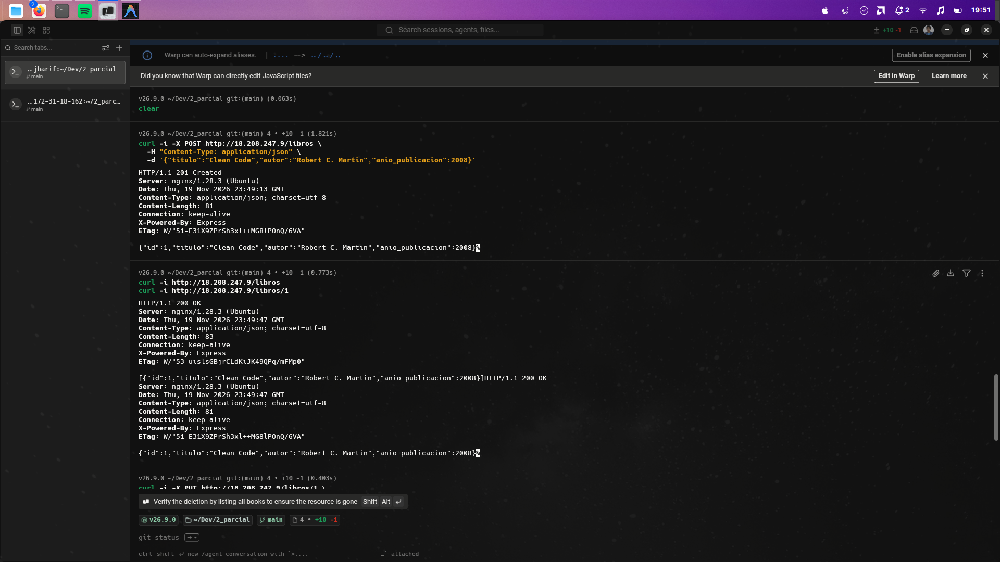
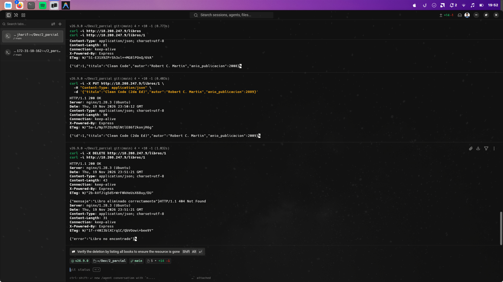

# paso 2.1
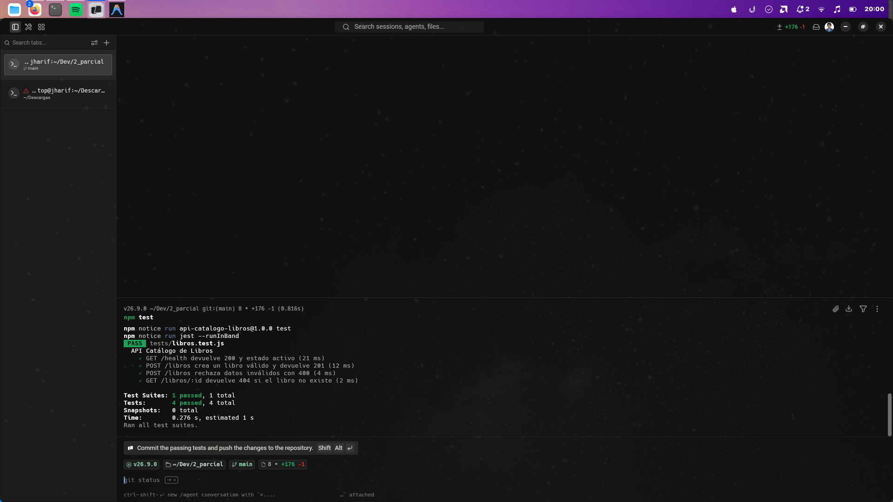

# paso 2.2
enlace: https://github.com/jharifAparicio/2_parcial/actions/runs/44642925785

# paso 2.3
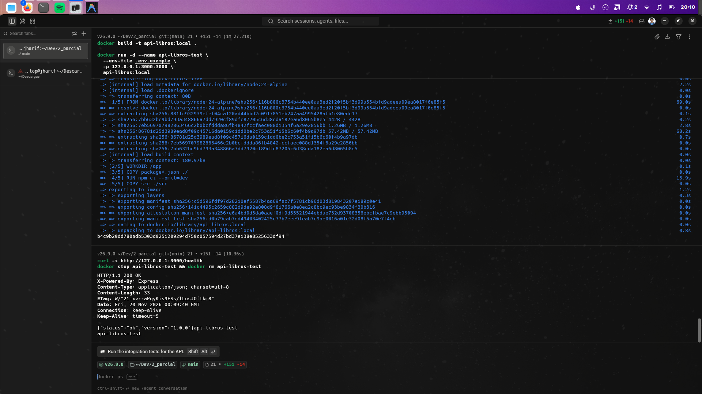

# paso 2.4
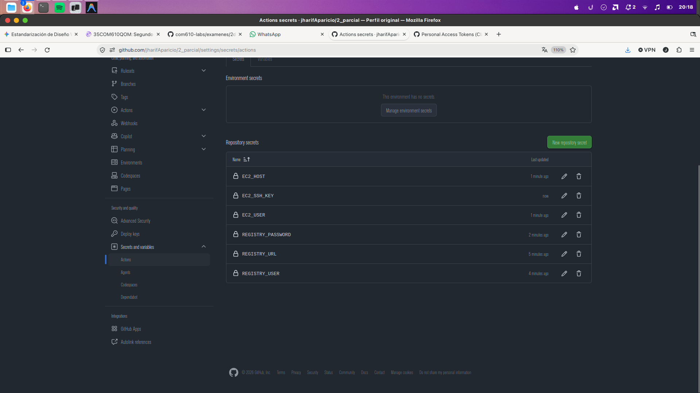

# paso 2.5
se instalo Docker en la EC2 y se probo la existencia del mismo
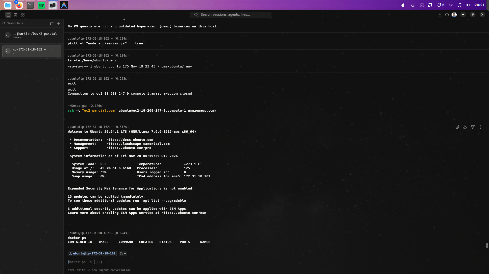

# paso 2.6
se probo el pipeline de despliegue automatico
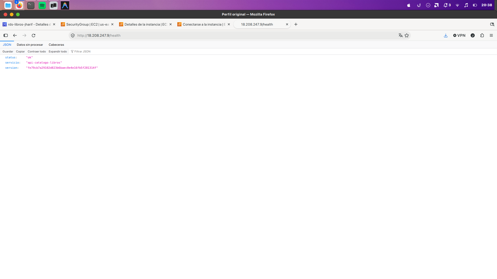